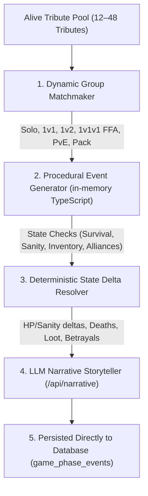
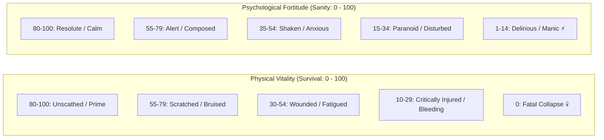
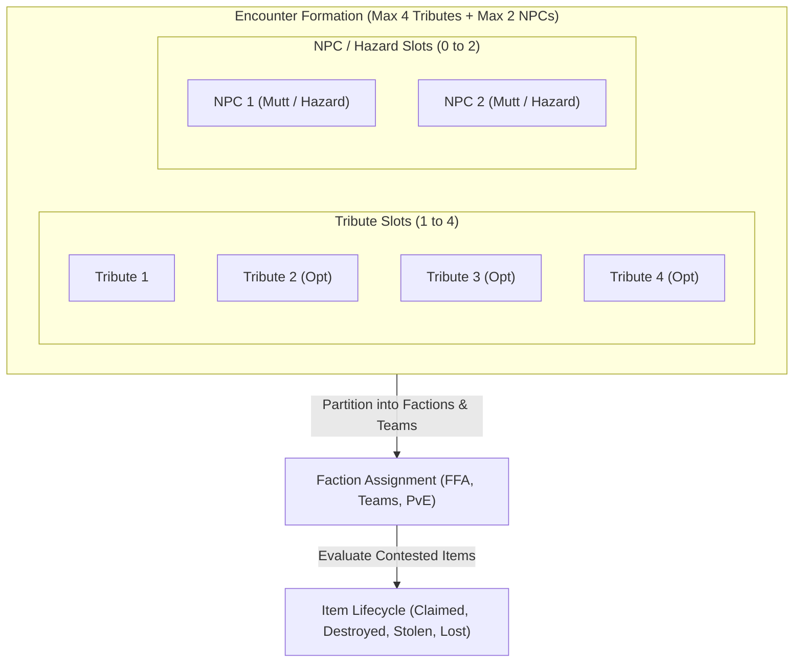
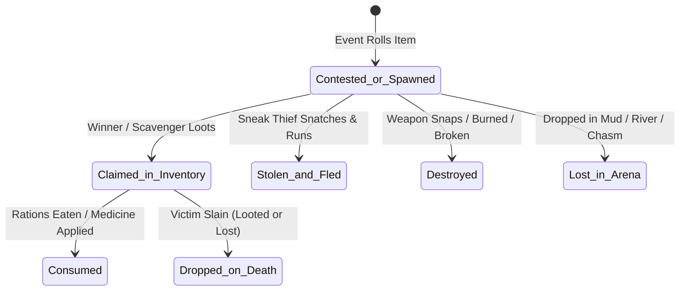

# Hunger Games AI — Simulation Engine & Master Event Architecture

> **Document Status**: Approved Technical & Gameplay Architecture Specification  
> **Last Updated**: 2026-08-31  
> **Related Documents**: [`live_arena_design.md`](./live_arena_design.md), [`database_schema.md`](./database_schema.md), [`simulation_rules_and_customizations.md`](./simulation_rules_and_customizations.md), [`routes_and_ux_flow.md`](./routes_and_ux_flow.md)

---

## 1. Executive Summary & Engine Philosophy

In Hunger Games AI, all arena outcomes (combat, injuries, item acquisitions, casualties, alliance formations, betrayals) are **100% deterministic** and computed by the procedural simulation engine based on mathematical RNG, tribute survival/sanity biometrics, active inventory, and Gamemaker rules.

The **Large Language Model (LLM)** never determines outcomes—it acts strictly as the **Storyteller & Broadcaster**, transforming raw state transitions into immersive, sensory narratives.



---

## 2. Match Startup & Initial Arena Bootstrap

When launching from the **Setup Wizard (`/setup`)** into the **Live Arena View (`/game/[id]`)**, the engine immediately evaluates 8 foundational parameters:

| Parameter | Configuration Key | Immediate Impact at Match Start |
| :--- | :--- | :--- |
| **Opening Phase** | `enableBloodbath` (`true`/`false`) | • **`true` (Default)**: Starts at **Phase 0 / Day 0: The Bloodbath (`BB`)** around the Cornucopia horn.<br>• **`false`**: Bypasses Bloodbath and starts at **Phase 1 / Day 1: Day Phase (`1 D`)** with tributes scattered into the wild. |
| **Arena Identity & Lore** | `simulationTitle`, `arenaName`, `arenaDescription` | Injected into Top Broadcast Header UI and foundational AI system prompt for environmental flavor (terrain, weather, Cornucopia horn architecture). |
| **Opening Lethality** | `combatLethality` (`high_bloodbath`, `balanced`, `gritty_survival`) | Calibrates Cornucopia casualty rate: `high_bloodbath` eliminates 30–50% of roster in Phase 0; `gritty_survival` biases toward fleeing with minimal casualties. |
| **Opening Alliances** | `allianceDynamic` (`career_pack`, `dynamic_pacts`, `lone_wolves`) | • `career_pack`: Districts 1, 2, 4 immediately form a hunting pack at the horn.<br>• `dynamic_pacts`: District partners / compatible archetypes group up.<br>• `lone_wolves`: Zero initial alliances; 100% solo free-for-all. |
| **Turn Granularity** | `turnGranularity` (`event_by_event`, `full_phase`, `autoplay`) | Configures viewport playback: step-through encounter by encounter vs. batch phase rendering vs. automated streaming. |
| **Pacing Speed** | `pacing` (`cinematic`, `normal`, `instant`) | Calibrates typewriter token streaming speed and suspense delays before casualty reveals. |
| **Narrative Voice** | `narrativeVoice` (`novel_cinematic`, `capitol_broadcast`, `gamemaker_log`) | Calibrates LLM persona: 3rd-person novel prose vs. flamboyant Caesar Flickerman commentary vs. tactical surveillance log. |
| **Tribute Biometrics** | `tributes` array | Initializes each tribute at `survival: 50`, `sanity: 50`, `physical_tag: "unscathed"`, `mental_tag: "composed"`, `status: "alive"`, `kill_count: 0`, `inventory: []`. |

---

## 3. Tribute Biometric State Model (`Survival` & `Sanity`)

Rather than artificial RPG attributes (STR, AGI, INT, HP), the simulator uses two **0–100 behavioral gauges** accompanied by contextual qualitative tags.



### A. The `Survival` Gauge (Physical Vitality: 0–100)
- **Baseline**: `50` (Standard physical condition entering the arena).
- **Increases (+)**: Clean water, cooked food, bandaging wounds, medicine sponsor drops, resting in shelter.
- **Decreases (-)**: Weapon cuts, burns, hypothermia, poison, dehydration, exhaustion.
- **0 Threshold**: Fatal bodily collapse / death.
- **Physical Condition Tags**: `unscathed`, `scratched`, `bruised`, `wounded`, `critically_injured`, `poisoned`, `freezing`, `starving`, `fatal`.

### B. The `Sanity` Gauge (Mental Fortitude: 0–100)
- **Baseline**: `50` (Alert, tense anticipation).
- **Increases (+)**: Alliance bonding, feeling safe, discovering a secure hiding spot, triumph over a threat.
- **Decreases (-)**: Total darkness/isolation, witnessing allies die, tracker jacker venom hallucinations, Gamemaker terror sirens, paranoia.
- **Behavioral Thresholds**:
  - `Sanity < 25`: Unlocks **Paranoid Betrayal** (striking allies out of fear), **Erratic Panic** (screaming in the dark, accidental signal fires), and reckless combat gambits.
  - `Sanity > 75`: Enables cold tactical patience, stealthy ambush placement, and disciplined resource rationing.
- **Mental State Tags**: `resolute`, `calm`, `composed`, `alert`, `anxious`, `shaken`, `paranoid`, `disturbed`, `delirious`, `manic`.

---

## 4. Slot-Based Battle & Event Architecture (Max 4 Tributes + Max 2 NPCs)

Every encounter in the arena is modeled as a **Slot-Based Dynamic Formation**:
* **Tribute Slots**: **Max 4 Tributes** ($T_1, T_2, T_3, T_4$) per event.
* **NPC / Hazard Slots**: **Max 2 NPCs** ($N_1, N_2$) per event (Capitol Mutts, Environmental Hazards, Predator Beasts).



### A. All Supported Tribute Slot Combinations

The system evaluates all mathematical team and free-for-all combinations across 1 to 4 tribute slots:

```
+---------------------------------------------------------------------------------------------------+
| SLOTS & FORMAT      | FACTION PARTITIONING   | POSSIBLE OUTCOME BRANCHES                                  |
+---------------------------------------------------------------------------------------------------+
| 1 Tribute (Solo)    | {T1}                   | • Solitary foraging / item discovery / resting             |
|                     | {T1} vs {N1} (PvE)     | • Solo vs 1–2 NPCs (flee, injure, slay beast, or die)     |
+---------------------+------------------------+-----------------------------------------------------------+
| 2 Tributes          | {T1} vs {T2} (1v1)     | • Attacker kills Defender (1 Death)                       |
|                     |                        | • Attacker wounds Defender (Defender flees)               |
|                     |                        | • Mercy / Standoff: Both separate peacefully              |
|                     |                        | • Mutual Destruction: Both kill each other 💀💀           |
|                     | {T1, T2} vs {N1} (Coop)| • Allied Duo fights NPC (cooperative defense, 0–2 deaths) |
+---------------------+------------------------+-----------------------------------------------------------+
| 3 Tributes          | {T1} vs {T2} vs {T3}   | • 1v1v1 FFA Chaos: All 3 die 💀💀💀                       |
|                     | (3-Way Free-For-All)   | • 1 Victor eliminates both rivals (2 Deaths)              |
|                     |                        | • 1 dies, other 2 scatter in separate directions (1 Death)|
|                     |                        | • Spontaneous 2v1: 2 temporarily gang up on the 3rd       |
|                     | {T1} vs {T2, T3}       | • 1v2 Asymmetric Pack Ambush (Pack kills solo, solo kills |
|                     |                        |   1 and runs, or solo heroically kills both)              |
|                     | {T1, T2, T3} vs {N1,N2}| • 3-Tribute Pack fights 1–2 Mutts/Hazards                 |
+---------------------+------------------------+-----------------------------------------------------------+
| 4 Tributes          | {T1} vs {T2} vs {T3}   | • 4-Way FFA Chaos: Up to 4 deaths, multi-casualty clash   |
|                     | vs {T4} (4-Way FFA)    | • 1 Victor stands alone over 3 fallen rivals              |
|                     | {T1, T2} vs {T3, T4}   | • 2v2 Squad War: Alliance vs Alliance clash (0–4 deaths)  |
|                     | {T1} vs {T2, T3, T4}   | • 1v3 Desperate Stand: Solo ambushed by a 3-person pack   |
|                     | {T1, T2, T3, T4} vs N  | • 4 Tributes (Allied or Truce) fighting 1–2 Alpha Mutts   |
+---------------------------------------------------------------------------------------------------+
```

---

## 5. Dynamic Item Lifecycle & Arena-Thematic Generation

### A. Dynamic Item Lifecycle State Machine
Items in events are not static badges—they have a complete, reactive lifecycle:



1. **Contested Clashes (e.g. *"Larry and Ghost fight over a Titanium Spear"*):**
   - **`claimed`**: The victor adds the item to their `inventory` JSONB array.
   - **`stolen_and_fled`**: A tribute snatches the contested item and flees without engaging in lethal combat.
   - **`destroyed`**: The weapon shatters or snaps during the clash (`state_delta.items_destroyed`).
   - **`lost / dropped`**: The item is kicked off a cliff, submerged in deep water, or left in the mud.
2. **Combat Probability Scaling**: Armed tributes receive a $+25\%$ to $+40\%$ advantage in combat rolls against unarmed opponents.

---

### B. LLM Thematic Generation for Map Items & NPCs

The system uses the `arenaDescription` and environmental lore to dynamically generate **arena-thematic items and NPCs** tailored to that battleground:

| Arena Biome / Lore | Dynamically Generated Thematic Items | Dynamically Generated Thematic NPCs |
| :--- | :--- | :--- |
| **Frozen Tundra & Glaciers** | • Thermal Bear Pelt Cloak<br>• Ice Climbing Pick<br>• Whale Fat Blubber Torch | • Saber-toothed Frost Wolves (Mutt)<br>• Flash Whiteout Blizzard (Hazard)<br>• Thin Ice Crevasse Trap |
| **Tropical Rainforest Canopy** | • Bamboo Blowgun with Curare Darts<br>• Heavy Machete<br>• Antivenom Root Extract | • Golden Tracker Jacker Swarm (Mutt)<br>• Carnivorous Tree Pit Vipers<br>• Torrential Flash Mudslide |
| **Clockwork Quell / Tidal Arena** | • Conductive Copper Wire Spool<br>• Spiked Fish Trident<br>• Kevlar Netting | • Carnivorous Mandrill Pack (Mutt)<br>• Corrosive Acid Fog Wave<br>• 12 o'clock Tidal Wave Cataclysm |
| **Ruined Post-Apocalyptic City** | • Rusted Rebar Javelin<br>• Heavy Concrete Chisel<br>• Makeshift Gas Mask | • Sewer Stalker Blind Mutts<br>• Collapsing Skyscraper Rubble<br>• Toxic Smog Leak |

---

## 6. Persistent State Chains: Alliances & Betrayals (`game_alliances`)

### A. Dedicated `public.game_alliances` Relational Table
Alliances are persisted directly in Postgres to enable seamless historical time-travel, instant Game Hub network graph queries, and RLS integrity:

```sql
create table public.game_alliances (
  id uuid primary key default gen_random_uuid(),
  game_id uuid not null references public.games(id) on delete cascade,
  tribute_ids uuid[] not null, -- Array of allied tribute UUIDs (2 to 6 tributes)
  status text not null default 'active' check (status in ('active', 'dissolved', 'betrayed')),
  formed_phase_id uuid references public.game_phases(id) on delete set null,
  dissolved_phase_id uuid references public.game_phases(id) on delete set null,
  betrayed_by_tribute_id uuid references public.tributes(id) on delete set null,
  created_at timestamptz not null default now()
);

-- Fast lookup index for active game alliances
create index game_alliances_game_status_idx on public.game_alliances(game_id, status);
create index game_alliances_tributes_gin_idx on public.game_alliances using gin(tribute_ids);
```

### B. Persistent Alliance Lifecycle & Matchmaking
1. **Pact Formation**: Two or more tributes forming an alliance are inserted into `public.game_alliances` with `status = 'active'`, `formed_phase_id = current_phase_id`.
2. **Cooperative Matchmaking**: Allied tributes are paired together for shared night camps, joint foraging, and multi-tribute squad clashes (2v2 or 2v1).
3. **Betrayal & Dissolution Mechanics**:
   - Triggered by low `Sanity (<25)`, extreme resource scarcity, or the endgame phase ($\le 4$ tributes remaining).
   - The betrayal event executes (e.g. *"Ghost pushes Larry from a high cliff"*).
   - The engine updates `public.game_alliances` set `status = 'betrayed'`, `dissolved_phase_id = current_phase_id`, `betrayed_by_tribute_id = killer_id`.
   - The victim's status transitions to `'dead'`, while the killer receives $+1$ `kill_count`.

---

## 7. Database Normalization & Performance Evaluation

| Architectural Element | Strict 3NF Approach | Implemented Pragmatic Design | Rationale & Performance Benefit |
| :--- | :--- | :--- | :--- |
| **`game_id` on `game_phase_events`** | Derived via `phase_id -> game_phases.game_id`. | Included and indexed on `game_phase_events`. | **Single-Hop RLS**: Evaluates `(select auth.uid())` in 1 subquery instead of a 3-table join chain, reducing latency by ~60%. |
| **Participant Tracking** | Join table `event_participants (event_id, tribute_id, role)`. | Native PostgreSQL `UUID[]` arrays (`tribute_ids`, `killer_ids`, `victim_ids`). | **Zero Join Overhead**: Eliminates thousands of join rows. GIN indexing provides $O(1)$ array queries (`@>`). |
| **Casualty Summary** | Aggregated query on `tributes` or `game_phase_events`. | Denormalized `fallen_tribute_ids (UUID[])` on `game_phases`. | **Instant Left Rail UI**: Left-hand phase pills render casualty markers (`💀`) with a single table read. |
| **AI Narrative Caching** | Dynamically re-prompted on view. | Cached in `narrative_text` column on `game_phase_events`. | **Zero Token Cost on Replay**: Guarantees deterministic match history and free past phase reviews. |

---

## 8. AI Storyteller Payload Integration (`/api/narrative`)

The engine serializes the rich deterministic outcome into a structured JSON payload for LLM generation:

```json
{
  "simulation_title": "The 74th Annual Hunger Games",
  "arena_name": "Verdant Woodlands & Golden Cornucopia",
  "arena_lore": "Freezing Alpine Pines, craggy ravines, and sudden blizzards.",
  "narrative_voice": "novel_cinematic",
  "event_category": "combat",
  "outcome_type": "death",
  "participants": [
    {
      "id": "tribute-1",
      "name": "Larry",
      "district": 11,
      "survival": 32,
      "physical_tag": "critically_injured (deep spear gash)",
      "sanity": 18,
      "mental_tag": "paranoid (hearing phantom voices)",
      "inventory": ["hunting knife"],
      "role": "victim"
    },
    {
      "id": "tribute-2",
      "name": "Ghost",
      "district": 2,
      "survival": 85,
      "physical_tag": "unscathed",
      "sanity": 60,
      "mental_tag": "cold_calculating",
      "inventory": ["titanium spear"],
      "role": "killer"
    }
  ],
  "state_delta": {
    "fatalities": ["tribute-1"],
    "health_changes": { "tribute-1": -32 },
    "sanity_changes": { "tribute-2": -5 },
    "loot_transferred": { "tribute-2": ["hunting knife"] }
  }
}
```
