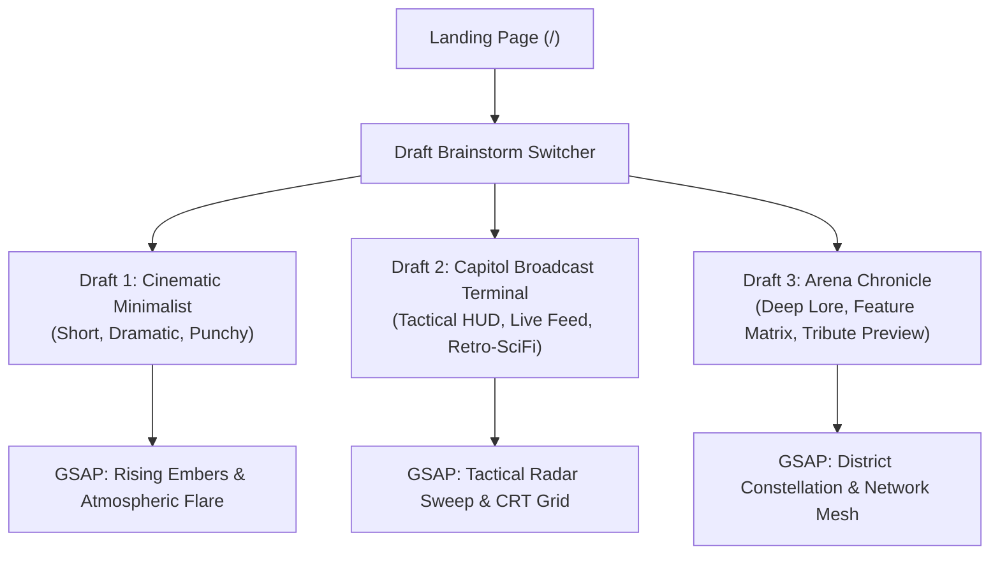

# Hunger Games Ad-Infinitum — Landing Page Design System & Architecture

> **Document Status**: Active Implementation Specification  
> **Last Updated**: 2026-08-26  
> **Related Documents**: [`routes_and_ux_flow.md`](./routes_and_ux_flow.md), [`technical_stack.md`](./technical_stack.md)

---

## 1. Executive Summary & Purpose

The landing page (`/`) serves as the primary gateway into **Hunger Games Ad-Infinitum**, an autonomous, AI-narrated procedural arena simulator. 

### Core Goals:
1. **Immediate Brand Impact**: Prominently feature the title **"Hunger Games Ad-Infinitum"** with a rich Capitol / Panem aesthetic.
2. **Zero-Friction Entry**: Always present two primary pathways:
   - **"Create Your Account"**: Cloud persistence, custom tribute creator studio, Capitol archives, token balance management.
   - **"Continue as Guest"**: 1-click immediate play, anonymous session initialization, zero login requirements.
3. **Draft Brainstorm Swapper**: An interactive, live switcher allowing developers and stakeholders to preview and compare three distinct design philosophies with tailored GSAP visual engines.

---

## 2. The Three Creative Brainstorm Drafts



---

### Draft 1: Cinematic Minimalist ("Mockingjay's Call")

- **Philosophy**: Extreme focus, high cinematic contrast, dramatic typographic hierarchy.
- **Copy**:
  - *Headline*: **Hunger Games Ad-Infinitum**
  - *Subtitle*: *“An infinite procedural arena simulator powered by autonomous AI narrative intelligence.”*
- **Layout**: Centered hero typography above a balanced dual-card grid.
- **GSAP Background**: `BackgroundEmbers` — Rising ember particles with dynamic drift velocity, opacity pulsing, and active palette luminescence.

---

### Draft 2: Capitol Broadcast Terminal ("Panem TV / Tactical HUD")

- **Philosophy**: Gamemaker command deck, tactical telemetry readouts, retro-futuristic broadcast aesthetic.
- **Copy**:
  - *Headline*: **HUNGER GAMES // AD-INFINITUM**
  - *Sub-tagline*: *“CAPITOL SURVEILLANCE & ARENA ORCHESTRATION TERMINAL”*
  - *Live Broadcast Ticker*: Simulated real-time tribute status and event log transmissions.
- **Layout**: Tactical HUD border chamfers, status badges (`[TRANSMISSION: LIVE]`, `[ARENA: CALIBRATING]`), technical data overlays.
- **GSAP Background**: `BackgroundRadarGrid` — Rotating radar sweep needle, concentric telemetry targeting rings, scanline grid shimmers.

---

### Draft 3: The Arena Chronicle ("Deep Narrative & Feature Showcase")

- **Philosophy**: Comprehensive storytelling, world-building lore, mechanics breakdown, and interactive preview.
- **GSAP Background**: `BackgroundConstellation` — Interconnected district node graph with glowing energy pulses and floating orbital motes.

#### Chronicle Compactness Spectrum (4 Sub-Drafts):

1. **3A. Bento Dashboard (`ChronicleBentoGrid`)**:
   - High-density modern layout.
   - Dual Auth Cards above an integrated bottom Bento row housing the 3 Architecture micro-chips (`[Procedural Combat]`, `[AI Narrative]`, `[Tribute Studio]`) and a live tribute telemetry status chip.
   - Perfect ~1 viewport fit on standard laptop displays.

2. **3B. Split Console (`ChronicleSplitDeck`)**:
   - 2-Column cockpit layout.
   - Left: Title, narrative lore summary, stacked feature pills, and mini telemetry badge.
   - Right: Stacked Capitol Citizen registration card and Continue as Guest card.

3. **3C. Tabbed Console (`ChronicleInteractiveDeck`)**:
   - Interactive 3-tab game hub (`01. Launch & Auth`, `02. Engine Pillars`, `03. Live Telemetry`).
   - Minimalist vertical footprint with fast tactile exploration.

4. **3D. Chronicle Expanded (`DraftArenaChronicle`)**:
   - Original spacious full-page presentation with full-sized feature cards and large tribute preview widget.

---

## 3. Mandatory Account vs. Guest Card Matrix

Across all three drafts, the two onboarding cards remain the primary actionable call-to-actions:

| Capability | Continue as Guest Card | Create Your Account Card |
|---|---|---|
| **Entry Friction** | **Zero** (1-click play) | **Minimal** (OAuth Google/Discord/Email) |
| **Active Games** | 1 session in local storage / anonymous DB | Unlimited cloud-saved simulations |
| **Tribute Customizer** | Standard presets & randomizer | Custom tribute studio with saved rosters |
| **Capitol Archives** | Cleared on browser reset | Permanent historical victor chronicle |
| **Token Balances** | Free tier community allocation | Persistent AI token replenishment & passes |
| **Primary CTA** | `[ QUICK PLAY AS GUEST ]` $\rightarrow$ `/setup` | `[ INITIALIZE CITIZEN PROFILE ]` $\rightarrow$ `/login` |

---

## 4. GSAP Animation Architecture

All animations use `@gsap/react` with the `useGSAP` hook, strictly obeying the following rules:

1. **Client Lifecycle Scoping**: All GSAP timelines are wrapped inside `useGSAP` with an explicit `containerRef` scope to guarantee zero SSR issues and automatic unmount cleanup.
2. **Performance Optimization**:
   - Prefer GPU transforms (`transform`, `translate3d`, `scale`, `opacity`).
   - Canvas/SVG particle loops run at native 60fps with device pixel ratio scaling.
   - Reduced-motion queries (`prefers-reduced-motion`) are respected.
3. **Theme Dynamic Sync**: Background canvas and SVG visuals read `--primary`, `--accent`, and `--theme-glow` variables dynamically, ensuring instant reaction when the user alters the visual palette in `ThemeSidePanel`.

---

## 5. File Structure Reference

```
src/
├── app/
│   └── page.tsx                     # Main Landing Page orchestrator
├── components/
│   ├── landing/
│   │   ├── DraftSwitcherBar.tsx     # Floating brainstorm swapper bar
│   │   ├── AuthActionCards.tsx      # Dual Account vs Guest cards
│   │   ├── drafts/
│   │   │   ├── DraftMinimalist.tsx       # Draft 1 Component
│   │   │   ├── DraftCapitolTerminal.tsx  # Draft 2 Component
│   │   └── backgrounds/
│   │       ├── BackgroundEmbers.tsx        # GSAP Embers Canvas
│   │       ├── BackgroundRadarGrid.tsx     # GSAP Radar & Scanline HUD
│   │       └── BackgroundConstellation.tsx # GSAP Constellation Network
│   └── disclaimer/
│       └── ThemeSidePanel.tsx       # Universal 5-theme visual switcher
└── lib/
    └── theme-context.tsx            # Theme state & palette tokens
```
