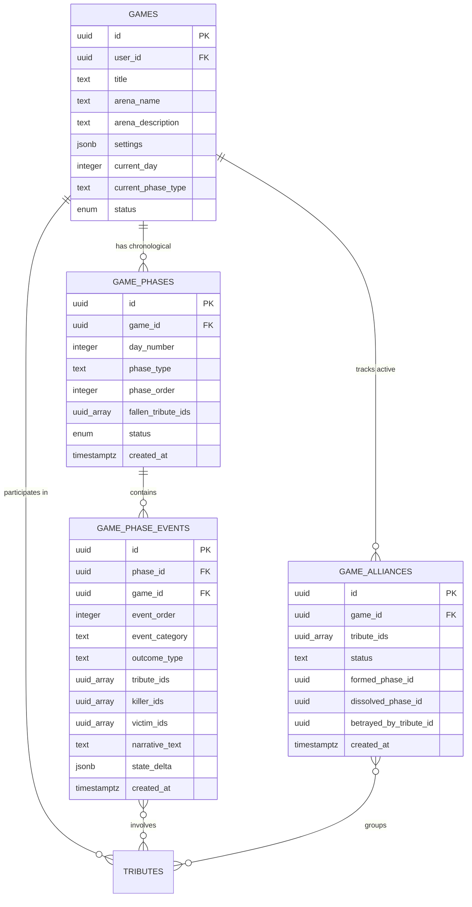
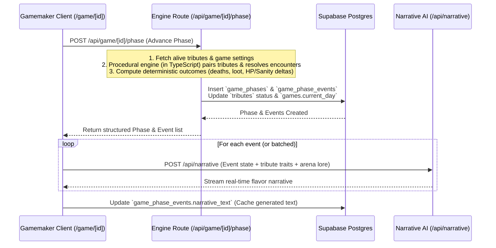

# Hunger Games AI — Live Arena Simulation View (`/game/[id]`) Design Specification

> **Document Status**: Approved UI/UX & Data Architecture Specification  
> **Last Updated**: 2026-08-31  
> **Related Documents**: [`routes_and_ux_flow.md`](./routes_and_ux_flow.md), [`database_schema.md`](./database_schema.md), [`simulation_rules_and_customizations.md`](./simulation_rules_and_customizations.md), [`technical_stack.md`](./technical_stack.md)

---

## 1. Executive Summary & Design Philosophy

The **Live Arena View (`/game/[id]`)** is the centerpiece of the Hunger Games AI experience. It presents procedural matches with extreme narrative focus and zero visual clutter.

### Core UX Principles:
1. **Phase-Isolated Focus**: The main viewport is strictly focused on the **events of a single phase at a time**. No bloated sidebars, distracting complex meters, or overlapping popups clutter the reading experience.
2. **Effortless Phase Navigation**: A left-hand scrollable rail lets Gamemakers jump back to past phases (`BB`, `1 D`, `1 N`, `2 D`, `2 N`, ...) to review earlier clashes or return to the active live phase.
3. **Decoupled Game Hub**: Full roster statistics, tribute telemetry, district casualty breakdowns, and inventory matrices are housed in the dedicated **Game Hub** (accessible via the right-hand **"Go to Gamehub"** button), keeping the live arena stream clean and readable.
4. **Deterministic Procedural State + AI Storyteller**: All combat outcomes, injuries, alliances, and deaths are computed deterministically by the procedural engine, while the LLM generates sensory, atmospheric narrative text for each event.

---

## 2. Layout & Wireframe Specification

The interface follows the focused wireframe layout illustrated below:


```
+-----------------------------------------------------------------------------------------------+
| [Simulation Title]                                                        [Day Number]        |
|  Arena Name                                                                Phase Badge        |
+-----------------------------------------------------------------------------------------------+
|          |                                                                   |                |
| [PHASE   |   +-----------------------------------------------------------+   |  [GO TO        |
|  NAV]    |   | EVENT CARD 1                                              |   |   GAMEHUB]     |
|          |   | Participating Tributes | Narrative Text | Outcome Delta   |   |                |
| • BB     |   +-----------------------------------------------------------+   |                |
| • 1 D    |   | EVENT CARD 2                                              |   |                |
| • 1 N    |   | Participating Tributes | Narrative Text | Outcome Delta   |   |                |
| • 2 D    |   +-----------------------------------------------------------+   |                |
| • ...    |   | EVENT CARD 3                                              |   |                |
|          |   | Participating Tributes | Narrative Text | Outcome Delta   |   |                |
|          |   +-----------------------------------------------------------+   |                |
|          |                                                                   |                |
+-----------------------------------------------------------------------------------------------+
|                           [ < PREV PHASE ]       [ NEXT PHASE > ]                             |
+-----------------------------------------------------------------------------------------------+
```

---

## 3. UI Component Breakdown

### A. Top Broadcast Header
- **Left Column**:
  - **Simulation Title**: e.g., *"The 74th Annual Hunger Games"* (font: serif bold, tracking wider).
  - **Arena Name**: e.g., *"Verdant Woodlands & Golden Cornucopia"* (accent color, font: mono/sans).
- **Right Column**:
  - **Day Number**: e.g., `DAY 0` (Bloodbath) or `DAY 1`, `DAY 2`, etc.
  - **Phase Type Badge**: High-visibility status badge with distinct thematic styling:
    - 🩸 `BLOODBATH` (Day 0 Opening Cornucopia clash)
    - ☀️ `DAY PHASE` (Exploration, Foraging & Skirmishes)
    - 🌙 `NIGHT PHASE` (Encampments, Fallen Anthem & Mutts)
    - 🍖 `FEAST` (Mid-Game Cornucopia Supply Clash)

---

### B. Left Scrollable Phase Navigator
A sticky, slim vertical navigation rail containing chronological phase pills:
- **Pill Syntax**:
  - `BB`: Bloodbath (Day 0)
  - `1 D` / `1 N`: Day 1 / Night 1
  - `2 D` / `2 N`: Day 2 / Night 2
  - `X F`: Feast Phase (if triggered)
- **Visual States**:
  - **Active / Selected Phase**: Highlighted with primary theme glow and active border.
  - **Casualty Marker**: Small red dot or skull icon (`💀`) indicating that one or more tributes died during that phase.
  - **Live Indicator**: Pulsing dot (`● LIVE`) on the latest unresolved phase.
- **Interaction**: Clicking any pill immediately switches the central viewport to that phase's event stack without triggering re-simulations.

---

### C. Central Arena Event Stack (Phase Events Feed)
A clean, vertical list of **Event Cards** belonging strictly to the selected phase.

Each **Event Card** features:
1. **Tribute Identity Badges**:
   - Avatars / silhouettes with District badges (e.g., `D12 Katniss`, `D2 Cato`).
   - Visual status styling (e.g., lethal blow highlight, wounded border, sponsor gift icon).
2. **Narrative Text Area**:
   - The rich LLM-generated flavor text capturing the encounter.
   - Supports real-time typewriter token streaming for live events, or instant display for reviewed past phases.
3. **Outcome Micro-Badges**:
   - Status deltas: `💀 KILLED`, `🩸 WOUNDED (-20 Survival)`, `⚡ PANIC (-25 Sanity)`, `🎁 SPONSOR DROP`, `⚔️ ESCAPED`, `🤝 ALLIANCE FORMED`, `🗡️ BETRAYAL`.
4. **Cannon Chime Banner** (for lethal events):
   - Dramatic Capitol cannon fire visual treatment when a death occurs.

---

### D. Right Action Zone: "Go to Gamehub"
- **Primary CTA**: **`[ Go to Gamehub ]`** button.
- **Function**: Transitions the user to the comprehensive **Game Hub** dashboard containing:
  - Full living tribute roster (Survival & Sanity telemetry meters, condition tags, active inventory items, kill counts).
  - Fallen tributes graveyard & death chronicle.
  - District standings and active alliance graph.
  - Arena environmental hazard status.
- *(Note: Game Hub is a separate view designed to keep the live event stream clean).*

---

### E. Bottom Phase Navigation Bar
Centered bottom controls for smooth forward and backward reading:
- **`[ < Prev Phase ]`**: Navigates to the immediately preceding phase (disabled on Bloodbath).
- **`[ Next Phase > ]` / `[ Advance Simulation ]`**:
  - If viewing a past phase: Advances to the next already-simulated phase.
  - If on the latest active phase: Triggers the procedural engine to simulate the next round, drawing events and updating tribute statuses.

---

## 4. Data & State Architecture

### A. Existing Tables in DB Schema ([`database_schema.md`](./database_schema.md))
- **`public.games`**: Tracks overall match state (`id`, `user_id`, `title`, `arena_name`, `arena_description`, `settings`, `current_day`, `current_phase_type`, `winner_id`, `status`).
- **`public.tributes`**: Tracks individual tribute state (`id`, `game_id`, `name`, `district`, `gender`, `personality`, `physical_aspect`, `status`, `kill_count`, `stats`, `inventory`, `death_phase_id`, `placement`).

---

### B. Required Database Schema Extensions for Phase & Event Tracking

To persist procedural phases and event narratives cleanly in Supabase, we introduce two relational tables:



#### 1. `game_phases` Table
Represents each chronological round in a game:
- `id` (`UUID`, PK, default: `gen_random_uuid()`)
- `game_id` (`UUID`, FK `-> games.id ON DELETE CASCADE`)
- `day_number` (`INTEGER`, e.g., `0` for Bloodbath, `1`, `2`, `3`...)
- `phase_type` (`TEXT`, `'bloodbath'` | `'day'` | `'night'` | `'feast'`)
- `phase_order` (`INTEGER`, 0-indexed sequential index across the entire match)
- `fallen_tribute_ids` (`UUID[]`, default: `'{}'`)
- `status` (`TEXT`, default: `'completed'`, check in `('pending', 'simulating', 'completed')`)
- `created_at` (`TIMESTAMPTZ`, default: `now()`)

#### 2. `game_phase_events` Table
Represents each deterministic event within a phase:
- `id` (`UUID`, PK, default: `gen_random_uuid()`)
- `phase_id` (`UUID`, FK `-> game_phases.id ON DELETE CASCADE`)
- `game_id` (`UUID`, FK `-> games.id ON DELETE CASCADE`)
- `event_order` (`INTEGER`, 0, 1, 2, 3...)
- `event_category` (`TEXT`, e.g., `'combat'`, `'forage'`, `'hazard'`, `'sponsor'`, `'mutt'`, `'social'`)
- `outcome_type` (`TEXT`, `'death'`, `'wound'`, `'loot'`, `'flee'`, `'alliance'`, `'idle'`)
- `tribute_ids` (`UUID[]`, participants)
- `killer_ids` (`UUID[]`, nullable)
- `victim_ids` (`UUID[]`, nullable)
- `narrative_text` (`TEXT`, rich sensory flavor text generated by LLM or deterministic template fallback)
- `state_delta` (`JSONB`, e.g. `{ "health_changes": { "<id>": -30 }, "item_loot": [...] }`)
- `created_at` (`TIMESTAMPTZ`, default: `now()`)

#### 3. `game_alliances` Table
Tracks dynamic alliance pacts and hunting packs:
- `id` (`UUID`, PK, default: `gen_random_uuid()`)
- `game_id` (`UUID`, FK `-> games.id ON DELETE CASCADE`)
- `tribute_ids` (`UUID[]`, array of allied tribute IDs)
- `status` (`TEXT`, `'active'`, `'dissolved'`, `'betrayed'`)
- `formed_phase_id` (`UUID`, FK `-> game_phases.id ON DELETE SET NULL`, nullable)
- `dissolved_phase_id` (`UUID`, FK `-> game_phases.id ON DELETE SET NULL`, nullable)
- `betrayed_by_tribute_id` (`UUID`, FK `-> tributes.id ON DELETE SET NULL`, nullable)
- `created_at` (`TIMESTAMPTZ`, default: `now()`)

---

## 5. Execution Flow & API Engine



---

## 6. Phase Progression Rules & Victory Conditions

1. **The Bloodbath (Day 0)**:
   - Initial Cornucopia clash (if `enable_bloodbath` is true in settings).
   - High lethality pool; tributes either contest supplies or flee into the perimeter.
2. **Day Phase (Day N)**:
   - Exploration, survival foraging, clashes, sponsor drops, and hazard encounters.
3. **Night Phase (Day N)**:
   - Campfire rests, hypothermia/predator hazards, and the **Fallen Anthem** recap of all tributes eliminated in Day N.
4. **Victory Trigger**:
   - **Sole Victor**: $\le 1$ tribute remains alive.
   - **District Duo Twist**: Exactly 2 tributes remain alive and share the same `district` number (if `victory_condition === 'district_duo_twist'`).
   - When victory is triggered, `games.status` is set to `'finished'`, `games.winner_id` is assigned, and the user is offered a transition to `/game/[id]/summary`.
