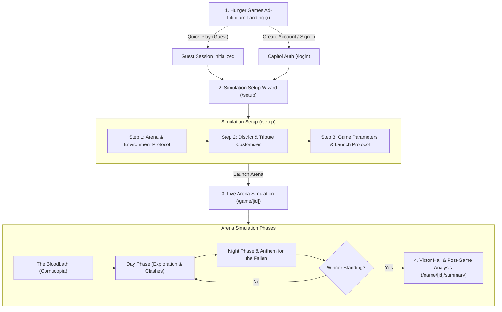
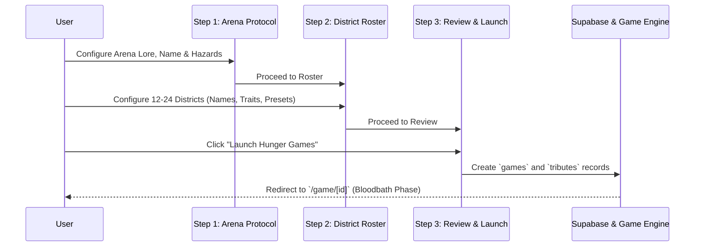

# Hunger Games AI — Routes, UX Flow & Auth Architecture

> **Document Status**: Approved Architecture Draft  
> **Last Updated**: 2026-08-25  
> **Related Documents**: [`architecture_analysis.md`](./architecture_analysis.md), [`database_schema.md`](./database_schema.md), [`nextjs_setup.md`](./nextjs_setup.md)

---

## 1. Executive User Flow Overview



---

## 2. Complete Next.js App Router Map

| Route Path | Type | Access Level | Description & Purpose |
|---|---|---|---|
| `/` | Page (Client) | Public | **Hunger Games Ad-Infinitum Landing**: Introductory landing page with 3 brainstorm drafts, GSAP background visuals, and Account vs. Guest onboarding cards. |
| `/lobby` | Page (RSC + Client) | Public / Guest | **Capitol Command Hub**: Central menu to launch a new simulation, resume in-progress games, view guest vs. member perks, and access lore/archives. |
| `/login` | Page (Client) | Public | **Dedicated Auth Portal**: Full-screen Capitol Terminal authentication with Google OAuth, Discord, and Email Magic Links. |
| `/auth/callback` | Route Handler | Public | **OAuth PKCE Exchange**: Server-side endpoint handling OAuth redirects from Supabase Auth and setting session cookies. |
| `/setup` | Page (Client) | Public / Guest | **3-Step Game Setup Wizard**: Arena and lore configurator, rules/hazard toggles, and interactive District tribute roster editor with randomizers. |
| `/game/[id]` | Page (Client + Streaming) | Public / Guest | **Live Arena Orchestrator**: The main game interface displaying real-time events, health/status monitors, LLM-streamed flavor narratives, and phase transitions. |
| `/game/[id]/summary` | Page (RSC + Client) | Public / Guest | **Victor's Hall & Statistics**: Post-game report detailing the winner, kill counts, lethal events timeline, and full narrative chronicle. |
| `/archives` | Page (RSC) | Registered | **Capitol Archives**: Saved simulations history, past victors, and exportable game chronicles (members only). |
| `/profile` | Page (RSC + Client) | Registered | **User Account & Tokens**: Manage profile, token balances for LLM generation, linked OAuth accounts, and pass tiers. |
| `/api/narrative` | Route Handler | Internal (Edge) | **LLM Narrative Generator**: Streams dynamic flavor text generated via Vercel AI SDK + OpenRouter. |
| `/api/game/[id]/phase` | Route Handler | Internal | **Game Engine Orchestrator**: Advances deterministic phase outcomes, draws event templates, and updates tribute statuses. |

---

## 3. Auth Architecture: Guest vs. Registered User Strategy

### A. The Two User Tiers

```
+------------------------------------+------------------------------------+
|            GUEST TIER              |          REGISTERED USER           |
+------------------------------------+------------------------------------+
| • 1 active game in progress        | • Unlimited saved games & history  |
| • Stored via Anonymous Auth        | • Token balance management         |
| • Full access to game simulation   | • Custom tribute presets & export  |
| • Can upgrade to account anytime   | • Capitol Archives access          |
+------------------------------------+------------------------------------+
```

### B. Supabase Anonymous Sign-In (Frictionless Onboarding)
1. When a user clicks **"Quick Play as Guest"**, the app silently calls `supabase.auth.signInAnonymously()`.
2. A temporary `user_id` (UUID) is created in Supabase. This satisfies foreign keys (`games.user_id`) without requiring a form fill.
3. **Seamless Account Upgrade**: If the guest later decides to save their game or buy tokens, they click **"Link Account / Save Progress"**. Supabase's `linkIdentity()` seamlessly connects their Google/Email credentials to the existing anonymous user UUID without losing the active game.

### C. OAuth & Authentication Providers
- **OAuth Providers**:
  - **Google** (Primary, zero-friction 1-tap sign in)
  - **Discord** (Gaming community favorite)
  - **GitHub** (Developer friendly)
- **Direct Auth**:
  - **Magic Link (Passwordless Email)** / Email + Password.
- **Form Factor**:
  - **Dedicated Page (`/login`)**: For direct navigation, bookmarking, and OAuth callbacks.
  - **Overlay Drawer/Modal (`<AuthDialog />`)**: Can be invoked from the navbar or inside `/setup` without navigating away from the current configuration.

---

## 4. Game & Arena Setup Form Specification (`/setup`)

The setup wizard is divided into three distinct, cinematic steps:



### Step 1: Arena & Environment Protocol
- **Simulation Title**: Default generated (e.g., *"The 74th Annual Hunger Games"*), editable by user.
- **Arena Identity & Lore Configuration**:
  - `Arena Codename / Custom Name`: User-specified or preset-derived arena title.
  - `Environmental Lore & Atmospheric Details`: Rich textarea (up to 1,200 chars) injected directly into real-time LLM storytelling prompts to steer tribute combat, survival tactics, and lethal encounters.
  - `Arena Presets`: Quick-load buttons for iconic arenas (e.g., *74th Forest & Cornucopia*, *75th Clockwork Quell*, *70th Frozen Tundra*, *Ruined Cityscape*).
- **Environmental Hazard Matrix**:
  - `Enable Bloodbath`: Opening Cornucopia clash (High lethality on Day 0).
  - `Enable Muttations`: Genetically engineered beasts released dynamically by Gamemakers.
  - `Enable Arena Disasters`: Acid rain, poison fog, floods, wall-of-fire traps.
  - `Enable Sponsor Drops`: Health kits, weapons, survival items dropped dynamically by Capitol patrons.

#### UI/UX & Persistence Specifications:
- **Continuous Draft Auto-Save (Zero-Friction)**:
  - No standalone "Save Arena Data" button for step progression; input changes and toggles automatically sync in real-time to `sessionStorage` (and local context).
  - A subtle Capitol status indicator (`● DRAFT SYNCED` / `READY`) gives live feedback so Gamemakers never worry about losing draft lore on accidental refresh.
  - *Explicit Save Distinction*: A dedicated save action is reserved solely for **"Save as Custom Preset"** (to reuse arena layouts in future games), keeping the step progression clean.
- **Primary Forward CTA ("Proceed to Tributes")**:
  - Validates minimum required fields (simulation title, arena name).
  - Locks in draft data and advances the active tab to `tributes`.
  - Supports keyboard accelerator (`Ctrl+Enter` / `Cmd+Enter`) for rapid workflow.
- **Top Bar Navigation Rules (`SetupHeaderNav`)**:
  - **Free Backward Navigation**: Gamemakers can click back to `Arena` at any point without losing tribute or rules data.
  - **Forward Navigation with Validation**: Clicking forward tabs (e.g., clicking *Tributes* while on *Arena*) executes the same validation and auto-save as the primary "Proceed" button. If validation fails, focus smoothly shifts to the missing input.
  - **Visual Readiness Status**: Top navigation tabs display visual readiness markers (`✓ Ready` dot) when step requirements are satisfied.


---

### Step 2: District & Tribute Customizer
- **District Configuration**:
  - Default: 12 Districts (2 Tributes each = 24 Tributes).
  - Expanded Mode: Up to 24 Districts (2 to 4 Tributes each = up to 48 Tributes).
- **Tribute Attributes per Card**:
  - **Full Name**: (e.g., *"Katniss Everdeen"*, *"Peeta Mellark"*).
  - **District & Gender/Pronoun**: Assigned slot (District 1–12, Male/Female/Non-Binary).
  - **Personality / Backstory**: Short text field (max 140 chars) to steer LLM dialogue and actions.
  - **Physical Aspect / Signature Trait**: Short visual prompt (e.g., *"Braided dark hair, swift runner, carrying a mockingjay pin"*).
- **Quick-Fill Automation & Presets**:
  - 🎲 **"Randomize All Tributes"**: Generates lore-accurate names and traits across all districts.
  - 📖 **"Preset: 74th Hunger Games"**: Instant fill with Katniss, Peeta, Cato, Clove, Rue, Foxface, Thresh, Marvel, etc.
  - 📖 **"Preset: 75th Quarter Quell"**: Instant fill with Finnick, Johanna, Beetee, Wiress, Enobaria, Brutus, etc.
  - 📋 **"Batch CSV/JSON Import"**: Paste custom list of tribute names.

---

### Step 3: Simulation Rules & Pacing Protocol (`/setup`)
> *See dedicated reference*: [`simulation_rules_and_customizations.md`](./simulation_rules_and_customizations.md) for full descriptions of all parameters.

- **Turn Granularity & Streaming Controls**:
  - `Turn Granularity`: **Event-by-Event (Step)** *(Default)* vs. **Full Phase in One Go (Batch)** vs. **Autonomous Auto-Play**.
  - `Narrative Streaming Speed`: **Cinematic Dramatic** *(Default)* vs. **Standard Speed** vs. **Instant Speedrun**.
- **Gamemaker Combat & Scenario Directives**:
  - `Combat Lethality Rate`: **Classic Balanced** *(6–8 days)* vs. **Bloodbath Surge** *(3–4 days)* vs. **Gritty Survivalist** *(8–10 days)*.
  - `Alliance & Betrayal Dynamics`: **Dynamic Pacts** vs. **Strict Lone Wolves** vs. **Career Pack Supremacy**.
  - `Mid-Game Cornucopia Feast`: Toggle mid-game supply clash at the horn.
  - `Victory Condition`: **Sole Victor Standing** vs. **District Duo Exemption (74th Twist)**.
- **Hazard-Bound Modifiers (Reactively Linked to Step 1)**:
  - `Sponsor Drop Generosity`: **Capitol Abundance** vs. **Standard Patronage** vs. **Famine / Hardcore** *(bound to `enableSponsorDrops`)*.
  - `Muttation Behavior`: **Final Climax Release** vs. **Dynamic Night Stalkers** *(bound to `enableMuttations`)*.
  - `Disaster Frequency`: **Moderate Periodic** vs. **Frequent Cataclysms** vs. **Reactive Stalls Only** *(bound to `enableDisasters`)*.
- **AI Narrative Voice**:
  - **Cinematic Novel Prose** *(3rd person novel)* vs. **Capitol Broadcast** *(Caesar Flickerman)* vs. **Gamemaker Tactical Log** *(Cold telemetry)*.
- **Pre-Flight Readiness Review**:
  - Modular synopsis cards for Arena, Roster Capacity, and Directives.
  - 1-click edit shortcuts back to steps 1 and 2.
  - Guest Anonymous vs. Capitol Cloud Account status.
- **Final Launch Action**:
  - **`[ SOUND THE CANNON & ENTER ARENA ]`** (with `Ctrl+Enter` / `Cmd+Enter` accelerator) → Serializes payload into DB / storage and initiates `/game/[id]`.

---

## 5. Transition Flow from Disclaimer Page (`/`)

1. **User lands on `/`**: Reads legal disclaimer and selects visual aesthetic theme (Mockingjay, Fire, Revolt, Serpent, Reaping).
2. **User checks acknowledgment and clicks "Enter the Simulation"**:
   - Client stores acknowledgment in `localStorage` (`hg_disclaimer_ack = true`).
   - Smooth GSAP exit transition routes user to `/lobby`.
3. **On `/lobby`**:
   - Top banner welcomes the user as a Capitol Gamemaker.
   - Primary Hero Action: **"INITIALIZE NEW GAMES"** (Takes user to `/setup`).
   - Secondary Actions: **"SIGN IN WITH GOOGLE"** (for saving games) or **"VIEW RULES & LORE"**.
