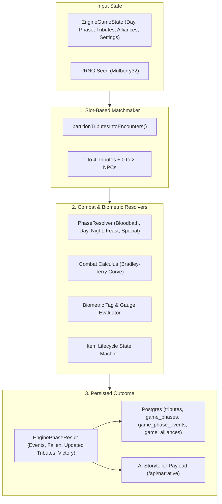
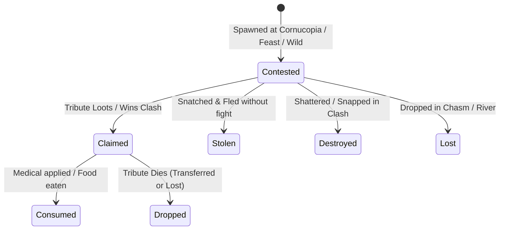
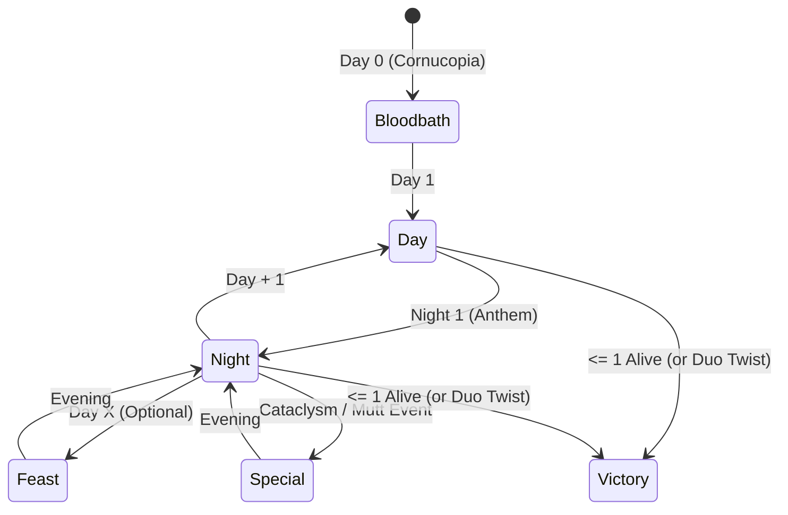

# Hunger Games AI — Master Simulation Engine Technical Reference

> **Document Status**: Authoritative Technical & Gameplay Engine Specification  
> **Last Updated**: 2026-09-02  
> **Target Audience**: AI Agents, Backend Developers, Game Designers  
> **Code Location**: [`src/lib/engine/`](file:///c:/jj_projects/hg-ai/src/lib/engine)  
> **Related Documents**: [`event_system_and_simulation_engine.md`](./event_system_and_simulation_engine.md), [`database_schema.md`](./database_schema.md), [`simulation_rules_and_customizations.md`](./simulation_rules_and_customizations.md), [`live_arena_design.md`](./live_arena_design.md)

---

## 1. Executive Summary & Core Philosophy

The Hunger Games AI simulation engine is a **purely deterministic procedural state machine** written in TypeScript. It computes all arena events, combat outcomes, tribute biometrics, inventory transactions, alliance pacts, and fatalities in memory.

### Core Architectural Axioms
1. **The LLM Never Decides Outcomes**: Large Language Models act strictly as sensory broadcasters and storytellers (`/api/narrative`). All combat rolls, item loot, wounds, alliances, and deaths are calculated mathematically before any AI call is triggered.
2. **Deterministic Reproducibility via PRNG**: Given the same match seed, game settings, and initial tribute roster, every phase advances through identical encounters, rolls, and outcomes.
3. **Slot-Constrained Mathematical Partitions**: Every encounter strictly bounds tributes to $[1, 4]$ and environmental NPCs/hazards to $[0, 2]$.
4. **Zero-Residue Persistence Protocol**: In tests and simulation benchmarks, test matches are created, executed, and unconditionally cleaned up in a `finally` block to prevent lingering database state.



---

## 2. Engine Module Directory & Architecture Map

All simulation code is isolated within [`src/lib/engine/`](file:///c:/jj_projects/hg-ai/src/lib/engine):

| File / Subdirectory | Purpose & Primary Exports | Key Responsibilities |
| :--- | :--- | :--- |
| [`index.ts`](file:///c:/jj_projects/hg-ai/src/lib/engine/index.ts) | Public API barrel export | Re-exports all domain types, resolvers, adapters, biometrics, and PRNG. |
| [`types.ts`](file:///c:/jj_projects/hg-ai/src/lib/engine/types.ts) | Engine Domain Types | `EngineTribute`, `EngineGameState`, `EnginePhaseResult`, `EngineEventOutcome`, `EncounterSlotFormation`. |
| [`constants.ts`](file:///c:/jj_projects/hg-ai/src/lib/engine/constants.ts) | Numerical Constants & Thresholds | Gauge thresholds, lethality multipliers, alliance limits, sponsor drop rates. |
| [`prng.ts`](file:///c:/jj_projects/hg-ai/src/lib/engine/prng.ts) | Seedable PRNG Engine | `Mulberry32PRNG`, `createPRNG`, `hashStringToSeed`, `generateDeterministicUuid`. |
| [`biometrics.ts`](file:///c:/jj_projects/hg-ai/src/lib/engine/biometrics.ts) | Biometric State Machine | `clampBiometric`, `evaluatePhysicalTag`, `evaluateMentalTag`, `applyBiometricDelta`. |
| [`alliances.ts`](file:///c:/jj_projects/hg-ai/src/lib/engine/alliances.ts) | Alliance & Cohesion Manager | `calculateTributeAffinity`, `calculateAllianceCohesion`, `evaluateAllianceBetrayalRisk`. |
| [`matchmaker.ts`](file:///c:/jj_projects/hg-ai/src/lib/engine/matchmaker.ts) | Slot Partitioner & Formation Engine | `partitionTributesIntoEncounters`, `extractTributeClusters`, `generatePartitionSizes`. |
| [`orchestrator.ts`](file:///c:/jj_projects/hg-ai/src/lib/engine/orchestrator.ts) | Master Phase Advancement | `advanceGamePhase`, `validatePhaseEventCoverage`, `assertPhaseCompleteness`. |
| [`adapters.ts`](file:///c:/jj_projects/hg-ai/src/lib/engine/adapters.ts) | Supabase $\leftrightarrow$ Engine Converters | `dbTributeToEngine`, `engineTributeToDbUpdate`, `enginePhaseResultToDbInserts`. |
| [`narrative-serializer.ts`](file:///c:/jj_projects/hg-ai/src/lib/engine/narrative-serializer.ts) | AI Storyteller Payload Builder | `serializeEventToNarrativePayload`, `computeParticipantRole`. |
| [`combat/calculus.ts`](file:///c:/jj_projects/hg-ai/src/lib/engine/combat/calculus.ts) | General Combat Power & 1v1 Clash | `calculateTotalCombatPower`, `calculateWinProbability`, `resolve1v1Clash`. |
| [`combat/lethality.ts`](file:///c:/jj_projects/hg-ai/src/lib/engine/combat/lethality.ts) | Lethality Calibration Curves | `scaleDamageByLethality`, `getCriticalFatalProbability`, `getStandoffProbability`. |
| [`combat/phase-calculus.ts`](file:///c:/jj_projects/hg-ai/src/lib/engine/combat/phase-calculus.ts) | Specialized Encounter Resolvers | `resolveBloodbathHornClash`, `resolveNightAmbush`, `resolveHazardEncounter`. |
| [`items/types.ts`](file:///c:/jj_projects/hg-ai/src/lib/engine/items/types.ts) | Item Domain Contracts | `EngineItem`, `ItemCategory`, `ItemTier`, `ItemLifecycleState`. |
| [`items/buffs.ts`](file:///c:/jj_projects/hg-ai/src/lib/engine/items/buffs.ts) | Tier Multipliers & Modifiers | `calculateWeaponBonus`, `calculateArmorMitigation`, `normalizeItems`. |
| [`items/lifecycle.ts`](file:///c:/jj_projects/hg-ai/src/lib/engine/items/lifecycle.ts) | Inventory State Transitions | `claimItem`, `stealItem`, `destroyItem`, `dropInventoryOnDeath`, `consumeItem`. |
| [`items/synthesizer.ts`](file:///c:/jj_projects/hg-ai/src/lib/engine/items/synthesizer.ts) | Dynamic Procedural Loot Generator | `generateThematicItemsForArena`, `generateSponsorDropItem`. |
| [`phases/`](file:///c:/jj_projects/hg-ai/src/lib/engine/phases) | Concrete Phase Implementations | `bloodbath.ts`, `day.ts`, `night.ts`, `feast.ts`, `special.ts`, `index.ts`. |

---

## 3. Tribute Biometric State Model

Instead of traditional RPG stats (STR, DEX, INT), each tribute is tracked by two continuous **0 to 100** behavioral gauges and qualitative tags.

```
       0                      30              55            80             100
SURVIVAL: [ Fatal 💀 ]-------[ Crit. Injured ]---[ Wounded ]---[ Scratched ]---[ Unscathed 🛡️ ]
SANITY:   [ Manic / Delirious ]--[ Paranoid ⚡ ]---[ Anxious ]---[ Composed ]----[ Resolute 🧠 ]
       0                      15              35            55             80
```

### 3.1 The `Survival` Gauge (Physical Vitality)
- **Baseline**: 50.0 (Arena start).
- **Bounds**: `[0, 100]`, clamped to 1 decimal place.
- **Death Threshold**: If $\text{Survival} \le 0$, `status` immediately flips to `"dead"` and `physicalTag = "fatal"`.

```typescript
export function evaluatePhysicalTag(survival: number): PhysicalConditionTag {
  if (survival <= 0) return "fatal";
  if (survival >= 80) return "unscathed";
  if (survival >= 55) return "scratched";
  if (survival >= 30) return "wounded";
  return "critically_injured"; // 1 to 29
}
```

### 3.2 The `Sanity` Gauge (Psychological Fortitude)
- **Baseline**: 50.0.
- **Bounds**: `[0, 100]`, clamped to 1 decimal place.
- **Behavioral Thresholds**:
  - `Sanity < 25`: **Paranoia State** (`isTributeParanoid`). Unlocks backstabs against allies, panic fires, hallucinations, and reckless attacks.
  - `Sanity < 15`: **Manic State** (`isTributeManic`). Severe combat penalty (-15% combat power).
  - `Sanity >= 75`: **Tactical Composure** (`isTributeTacticallyResolute`). +15% tactical focus bonus in combat rolls.

```typescript
export function evaluateMentalTag(sanity: number): MentalConditionTag {
  if (sanity >= 80) return "resolute";
  if (sanity >= 55) return "composed";
  if (sanity >= 35) return "anxious";
  if (sanity >= 15) return "paranoid";
  return "manic"; // 0 to 14
}
```

---

## 4. Slot Matchmaking & Encounter Formations

Every phase encounter is generated through dynamic slot matchmaking:
* **Tribute Slots**: $\min = 1, \max = 4$
* **NPC Slots**: $\min = 0, \max = 2$ (Mutts, Hazards, Beasts)

### 4.1 The Complete Encounter Formation Catalog

```
+-----------------------------------------------------------------------------------------------------+
| FORMATION TYPE            | SLOTS  | CATEGORY | FACTIONS & DESCRIPTION                              |
+-----------------------------------------------------------------------------------------------------+
| solo_forage               | 1 Trib | forage   | Solo tribute searching for wild resources or water. |
| solo_rest                 | 1 Trib | social   | Solo tribute hiding, recuperating, or scouting.     |
| solo_mishap               | 1 Trib | hazard   | Solo tribute suffering environmental accidents.     |
| solo_pve                  | 1 Trib | mutt     | 1 Tribute vs 1–2 Mutts or Hazards.                  |
+---------------------------+--------+----------+-----------------------------------------------------+
| duel_1v1                  | 2 Trib | combat   | {T1} vs {T2} direct lethal or wounding duel.        |
| standoff_1v1              | 2 Trib | combat   | {T1} vs {T2} tense armed confrontation (mercy/draw).|
| coop_pve_2                | 2 Trib | mutt     | {T1, T2} jointly fight 1–2 Mutts or Hazards.        |
| allied_camp_2             | 2 Trib | social   | Allied duo sharing shelter, fire, and sanity buff.  |
| peaceful_encounter_2      | 2 Trib | social   | Spontaneous truce between non-hostile tributes.     |
+---------------------------+--------+----------+-----------------------------------------------------+
| ffa_3way                  | 3 Trib | combat   | {T1} vs {T2} vs {T3} chaotic 3-way clash.           |
| ambush_1v2                | 3 Trib | combat   | {T1} vs {T2, T3} (Solo ambushed by a pack).         |
| spontaneous_truce_1v2     | 3 Trib | social   | 3 tributes negotiate uneasy temporary ceasefire.    |
| coop_pve_3                | 3 Trib | mutt     | Trio cooperative stand against Mutts/Cataclysms.    |
| allied_camp_3             | 3 Trib | social   | 3 allied tributes camping together.                 |
+---------------------------+--------+----------+-----------------------------------------------------+
| ffa_4way                  | 4 Trib | combat   | {T1} vs {T2} vs {T3} vs {T4} free-for-all mayhem.   |
| squad_war_2v2             | 4 Trib | combat   | {T1, T2} vs {T3, T4} Alliance vs Alliance clash.    |
| stand_1v3                 | 4 Trib | combat   | {T1} vs {T2, T3, T4} Desperate solo last stand.     |
| asymmetric_2v1v1          | 4 Trib | combat   | {T1, T2} vs {T3} vs {T4} multi-sided skirmish.      |
| squad_pve_4way            | 4 Trib | mutt     | 4 tributes (truce or allied) fighting Alpha Mutts.  |
+---------------------------+--------+----------+-----------------------------------------------------+
| bloodbath_horn_clash      | 2 Trib | combat   | Cornucopia mouth melee contesting high-tier weapon. |
| feast_supply_clash        | 2 Trib | combat   | Mid-game feast clash over district supply crates.   |
+-----------------------------------------------------------------------------------------------------+
```

### 4.2 Partition Sizing Algorithm
The matchmaker guarantees that **100% of alive tributes** participate in an encounter each phase:
1. Clusters active tributes by alliance into preserved groups.
2. Decomposes remaining tributes into slot partitions summing to the total alive count.
3. Randomly shuffles non-allied tributes to ensure varied pairing.
4. Fallback invariant: If 1 tribute remains unpartnered, they are assigned a solo forage, rest, or PvE event.

---

## 5. Combat Calculus & Lethality Curves

### 5.1 Base and Total Combat Power

Raw physical and mental combat potential is computed as:
$$\text{BasePower} = (\text{Survival} \times 0.6) + (\text{Sanity} \times 0.4)$$

Total Combat Power scales base power by equipment, biometrics, stances, and tactical conditions:
$$\text{TotalPower} = \text{BasePower} \times (1 + \text{WeaponBonus} + \text{ToolBonus}) \times \text{ConditionMult} \times \text{AmbushMult} \times \text{NumericalMult}$$

Where:
- **`ConditionMult`**:
  - `critically_injured`: $0.70$ (-30%)
  - `wounded`: $0.85$ (-15%)
  - `resolute`: $1.15$ (+15%)
  - `delirious` / `manic`: $0.85$ (-15%)
  - Others: $1.00$
- **`AmbushMult`**: $1.25$ (+25% surprise advantage)
- **`NumericalMult`**: $1.40$ (+40% advantage when outnumbering foes)

### 5.2 Win Probability (Bradley-Terry Exponent Curve)
Contests between Combatant $A$ and Combatant $B$ use a Bradley-Terry model with an exponent of $1.5$:

$$P(A \text{ wins}) = \frac{\text{Power}_A^{1.5}}{\text{Power}_A^{1.5} + \text{Power}_B^{1.5}}$$

This curve prevents absolute certainty while rewarding superior stats and weaponry:
* Equal power ($50$ vs $50$): $50.0\%$ win rate.
* Armed vs Unarmed ($75$ vs $45$): $\approx 68.3\%$ win rate for the armed tribute.
* Peak Career vs Starving Underdog ($110$ vs $25$): $\approx 90.2\%$ win rate.

### 5.3 Combat Lethality Calibration Table

The `combatLethality` setting alters damage multipliers, fatal strike chances, and standoff frequencies:

| Lethality Mode | Damage Multiplier | Base Fatal Probability | Standoff / Mercy Probability | Target Phase Casualty Rate |
| :--- | :---: | :---: | :---: | :--- |
| **`high_bloodbath`** | $1.35\times$ | $40\%$ | $10\%$ | 30%–50% roster eliminated in Bloodbath |
| **`balanced`** (Default) | $1.00\times$ | $20\%$ | $25\%$ | 15%–25% roster eliminated in Bloodbath |
| **`gritty_survival`** | $0.80\times$ | $8\%$ | $45\%$ | 5%–10% Bloodbath deaths; heavy injury rate |

Damage is mitigated by worn armor:
$$\text{DamageDealt} = \text{BaseDamage} \times \text{LethalityMultiplier} \times (1 - \text{ArmorMitigation})$$

---

## 6. Dynamic Items Lifecycle & Synthesizer

### 6.1 Item Categories & Rarity Tiers

Every item belongs to one of 5 categories and 4 rarity tiers:

| Item Tier | Weapon Bonus | Armor Mitigation | Tool Bonus | Medical Recovery | Sustenance Recovery |
| :--- | :---: | :---: | :---: | :---: | :---: |
| **`common`** | $+15\%$ | $15\%$ | $+10\%$ | $+20$ Sur, $+0$ San | $+15$ Sur, $+10$ San |
| **`uncommon`** | $+25\%$ | $25\%$ | $+15\%$ | $+35$ Sur, $+5$ San | $+20$ Sur, $+15$ San |
| **`rare`** | $+35\%$ | $35\%$ | $+25\%$ | $+50$ Sur, $+15$ San | $+30$ Sur, $+25$ San |
| **`legendary`** | $+50\%$ | $50\%$ | $+40\%$ | $+75$ Sur, $+25$ San | $+45$ Sur, $+35$ San |

### 6.2 Lifecycle State Machine



1. **`claimItem`**: Adds `EngineItem` to tribute's `inventory` array.
2. **`stealItem`**: Transfers item from victim inventory to thief inventory.
3. **`destroyItem`**: Removes item from inventory and tracks in `state_delta.items_destroyed`.
4. **`dropInventoryOnDeath`**: Upon death, weapons/tools are either looted by the killer or lost in the arena.

### 6.3 Procedural Arena-Thematic Item Synthesizer
The engine extracts keywords from `arenaDescription` and `arenaName` to dynamically synthesize biome-appropriate loot (e.g. *Ice Climbing Pick* in Tundra, *Curare Blowgun* in Rainforest, *Rusted Rebar Spear* in Urban Ruins).

---

## 7. Alliances, Cohesion & Betrayal Lifecycle

### 7.1 The Dual Alliance Model

```
+------------------------------------------------------------------------------------+
| SETTING DYNAMIC      | FORMATION RULES                                             |
+------------------------------------------------------------------------------------+
| career_pack          | Districts 1, 2, and 4 form an immediate horn pack.          |
| dynamic_pacts        | District partners & compatible archetypes form starting duo.|
| lone_wolves          | Zero initial alliances; 100% individual free-for-all.       |
+------------------------------------------------------------------------------------+
```

* **Capacity Limits**:
  - Small matches ($\le 12$ tributes): Max alliance cap $= 3$
  - Medium matches ($13–23$ tributes): Max alliance cap $= 4$
  - Standard matches ($\ge 24$ tributes): Max alliance cap $= 5$

### 7.2 Interpersonal Affinity & Pack Cohesion

Affinity between tributes is scored on a scale from $-100$ to $+100$:
* **Same District Partner**: $+75$ affinity.
* **Fellow Career (Districts 1, 2, 4)**: $+60$ affinity.
* **Paranoid Tribute ($\text{Sanity} < 25$)**: $-40$ affinity.

Pack Cohesion ($0$ to $100$) determines alliance resilience:
$$\text{Cohesion} = 55 + \text{DistrictBonus}(+25) + \text{CareerBonus}(+20) + \frac{\text{AvgSanity} - 50}{2} - \text{ParanoiaPenalty}(-35)$$

### 7.3 Betrayal & Fracture Mechanics
Betrayal risks are evaluated when:
1. **Psychological Breakdown**: Any member's $\text{Sanity} < 25$.
2. **Cohesion Fracture**: Cohesion drops below $25$.
3. **Endgame Threshold**: Total alive tributes in arena $\le 4$.

When betrayal strikes:
* The backstabber gains a $+35\%$ ambush power bonus (`ALLIANCE_AMBUSH_POWER_BONUS = 1.35`).
* The alliance record in `public.game_alliances` is updated: `status = 'betrayed'`, `betrayed_by_tribute_id = killer_id`.
* The victim's status changes to `'dead'`, while the killer gains $+1$ kill count.

---

## 8. Phase Execution Pipeline & Strategies



### 8.1 The 5 Phase Strategies

| Phase Type | Code Resolver | Primary Focus & Distinct Mechanics |
| :--- | :--- | :--- |
| **`bloodbath`** | [`phases/bloodbath.ts`](file:///c:/jj_projects/hg-ai/src/lib/engine/phases/bloodbath.ts) | Day 0 Cornucopia Horn clash. High casualty potential, contested top-tier weapons, Career sweeps vs. cowardly fleeing. |
| **`day`** | [`phases/day.ts`](file:///c:/jj_projects/hg-ai/src/lib/engine/phases/day.ts) | Daylight exploration, foraging for food/water, duels, ambushes, sponsor drops descending from the Capitol. |
| **`night`** | [`phases/night.ts`](file:///c:/jj_projects/hg-ai/src/lib/engine/phases/night.ts) | Cold exposure penalties, campfire bonding ($+15$ sanity), stealth assassinations, and paranoid night murders. Concludes with fallen tribute cannon count. |
| **`feast`** | [`phases/feast.ts`](file:///c:/jj_projects/hg-ai/src/lib/engine/phases/feast.ts) | Gamemaker invitation to Cornucopia with high-tier survival crates. Desperate, wounded tributes drawn into bloody clashes ($1.4\times$ damage). |
| **`special`** | [`phases/special.ts`](file:///c:/jj_projects/hg-ai/src/lib/engine/phases/special.ts) | Capitol Gamemaker interventions: Tracker Jacker swarms, acid fog, wildfire rings, carnivorous wolf Mutts. |

### 8.2 Victory Condition Evaluator
At the conclusion of every phase, `orchestrator.ts` evaluates the remaining alive tributes:
1. **Sole Victor**: Exactly 1 tribute alive $\to$ `winner_ids = [victor.id]`, `status = 'finished'`, placement = 1.
2. **Mutual Destruction**: 0 tributes alive $\to$ `winner_ids = []`, `status = 'finished'`, placements assigned by phase fall order.
3. **District Duo Twist**: If `settings.victoryCondition === "district_duo_twist"` and exactly 2 tributes remain from the same district $\to$ both are declared joint Victors.

---

## 9. Database Persistence & RLS Adapters

All database operations are mediated by [`src/lib/engine/adapters.ts`](file:///c:/jj_projects/hg-ai/src/lib/engine/adapters.ts):

### 9.1 Mapping Contracts
* **`dbTributeToEngine`**: Maps Supabase row `Tables<"tributes">` to `EngineTribute`. Safely parses JSONB `stats` and `inventory`.
* **`engineTributeToDbUpdate`**: Maps updated `EngineTribute` into strict database update payloads (`status`, `stats`, `inventory`, `kill_count`, `placement`, `death_phase_id`).
* **`enginePhaseResultToDbInserts`**: Transforms `EnginePhaseResult` into bulk inserts for `game_phases` and `game_phase_events`.

### 9.2 Coverage Assertion (Phase Invariant)
```typescript
assertPhaseCompleteness({
  livingTributes: gameState.tributes,
  phaseEvents: phaseEvents,
});
```
The orchestrator strictly enforces that **every living tribute must have an event record in the phase before the game can advance to the next phase**. Attempting to advance an incomplete phase throws an unrecoverable validation error.

---

## 10. AI Storyteller Serialization (`/api/narrative`)

The engine outputs structured events that serialize directly into the `/api/narrative` Zod schema:

```json
{
  "simulation_title": "The 74th Annual Hunger Games",
  "arena_name": "The Floor is Lava Caldera",
  "arena_lore": "Basalt pillars, sulfur geysers, and narrowing bridges.",
  "narrative_voice": "novel_cinematic",
  "event_category": "combat",
  "outcome_type": "death",
  "participants": [
    {
      "id": "c1f7289b-98b1-4f16-8bb0-2e02a0a2f701",
      "name": "Larry the Evil Cat",
      "district": 13,
      "survival": 82.5,
      "physical_tag": "unscathed",
      "sanity": 65.0,
      "mental_tag": "composed",
      "inventory": [{ "name": "Obsidian Claws", "tier": "rare" }],
      "role": "killer"
    },
    {
      "id": "d2f8390c-09c2-4a27-9cc1-3f13b1b3f802",
      "name": "Sentient Plastic Chair",
      "district": 13,
      "survival": 0.0,
      "physical_tag": "fatal",
      "sanity": 100.0,
      "mental_tag": "resolute",
      "inventory": [],
      "role": "victim"
    }
  ],
  "state_delta": {
    "fatalities": ["d2f8390c-09c2-4a27-9cc1-3f13b1b3f802"],
    "health_changes": { "c1f7289b-98b1-4f16-8bb0-2e02a0a2f701": -5.0, "d2f8390c-09c2-4a27-9cc1-3f13b1b3f802": -80.0 },
    "sanity_changes": { "c1f7289b-98b1-4f16-8bb0-2e02a0a2f701": 5.0 },
    "loot_transferred": {}
  }
}
```

### Participant Role Mapping
Roles are computed procedurally via `computeParticipantRole`:
* `killer`: Tribute in `event.killerIds`.
* `victim`: Tribute in `event.victimIds`.
* `attacker`: Slot 0 in combat.
* `defender`: Slot 1 in combat.
* `witness`: Slots 2–3 in combat.
* `scavenger`: Solo or duo in `forage` category.
* `ally`: Participants in `social` category.
* `solo`: Unpaired tribute in solo encounter.

---

## 11. Zero Database Residue & Testing Benchmark

When executing simulation tests or database benchmarks against Supabase DEV, all tests must implement the **Zero Residue Protocol**:

```typescript
let testGameId: string | null = null;
try {
  // 1. Create match in games table
  // 2. Insert canonical benchmark roster (26 tributes across 13 districts)
  // 3. Execute simulation phase(s)
  // 4. Assert 15/15 invariants
} finally {
  if (testGameId) {
    // Unconditional cascade deletion of all child records
    await supabase.from("games").delete().eq("id", testGameId);
  }
}
```

### Canonical Benchmark Match Roster
* **Arena**: `"The Floor is Lava Caldera"` (Volcanic custom arena).
* **Roster**: **26 Tributes** (24 Canon 74th Hunger Games tributes + District 13 custom entries: `'Larry the Evil Cat'` [predator] and `'Sentient Plastic Chair'` [stoic monobloc]).
* **Default Settings**: Bloodbath enabled, balanced combat lethality, dynamic pacts, cinematic pacing.
